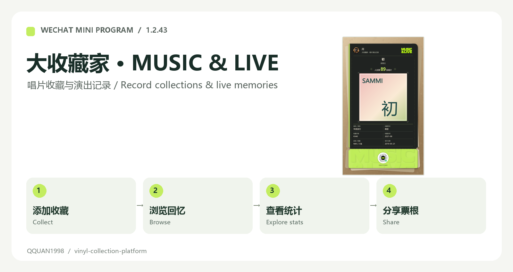
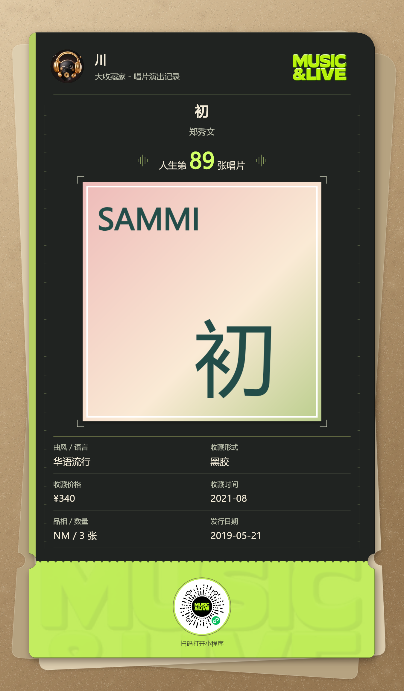
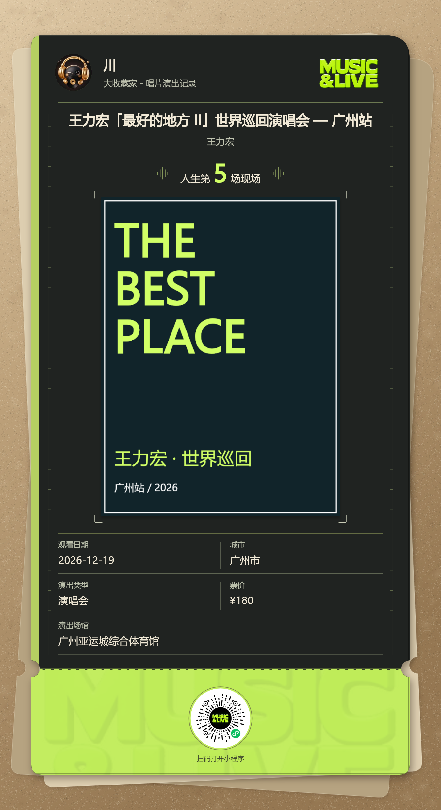
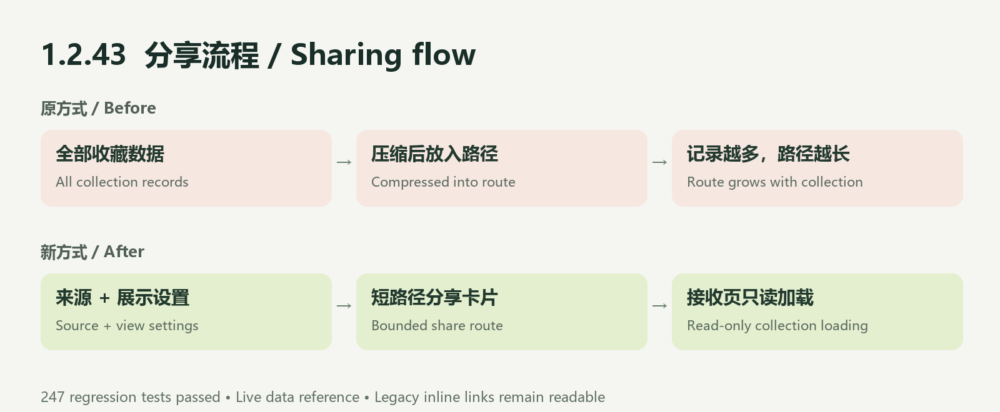

# MUSIC & LIVE · Personal Music Collection

[简体中文](README.md) · [1.2.43 release notes](docs/releases/1.2.43.en.md)



A WeChat mini program for cataloging physical records, remembering attended shows, exploring collection statistics, and sharing ticket-style posters.

## Features

| Area | What you can do |
| --- | --- |
| Record cabinet | Search, manually add or batch-enter records; track editions, media, quantities, condition, costs and collection dates |
| Live archive | Import supported event links or add shows manually; record dates, cities, venues and expenses; additions default to attended |
| Stats & timeline | Explore totals, yearly distribution, artist rankings, expenses and the full timeline |
| Sharing | Share collection pages, statistics and timelines; export record and show posters |
| Account tools | Import/export, TV pairing, illustrated instructions; Simplified/Traditional Chinese, English and Japanese |

## Poster examples

Actual Canvas exports with local sample data. These illustrate layout, not real user collections or authoritative release metadata.

| Record ticket | Show ticket |
| --- | --- |
|  |  |

## What's fixed in 1.2.43



Statistics sharing now carries a collection source and view settings in a bounded route instead of embedding the entire collection. The receiving page loads the shared collection read-only. The fix covers record statistics, show statistics and timelines, with retry handling and stale-share cache clearing.

**247 regression tests passed** before this source sync; package-reference checks passed. The experience build was uploaded and submitted for WeChat review on November 12, 2026. Submission does not mean approval or production release. Sending from a physical phone still needs device verification.

## Run locally

1. Install Node.js 22+, Python 3 and WeChat DevTools.
2. Import `apps/miniprogram` into WeChat DevTools. Configure your own AppID and cloud services; the identifiers in this source do not grant cloud access.
3. Configure your own backend database and environment variables using the [cloud hosting guide](docs/wechat-cloud-hosting.md). Keep secrets outside version control.
4. After editing the UI generation sources, run from the repository root:

```sh
python migration/apply-ui.py
node migration/verify-package.cjs
node --test migration/*.test.cjs apps/miniprogram/tests/*.test.js
```

Upload the generated `apps/miniprogram` directory. UI sources live in `migration/ui` and the patch scripts; `migration/baseline` holds the hash-checked original baseline. Rebuilding uses relative paths, not the author's machine paths.

## Repository layout

| Path | Contents |
| --- | --- |
| `apps/miniprogram` | Complete 1.2.43 native mini-program source |
| `migration` | Rebuildable UI sources, baseline and regression tests |
| `apps/api` | Existing Node.js API and database models |
| `apps/tv-apk` | TV application project |
| `packages/shared` | Shared types and rules |

Paid membership, rewarded ads, ticket sales and fan voting are not enabled in this build. Source access does not provide a hosted service account. Album artwork, artist names and third-party catalog data remain subject to their respective rights and terms. Public visibility does not itself grant a license to every included asset.
