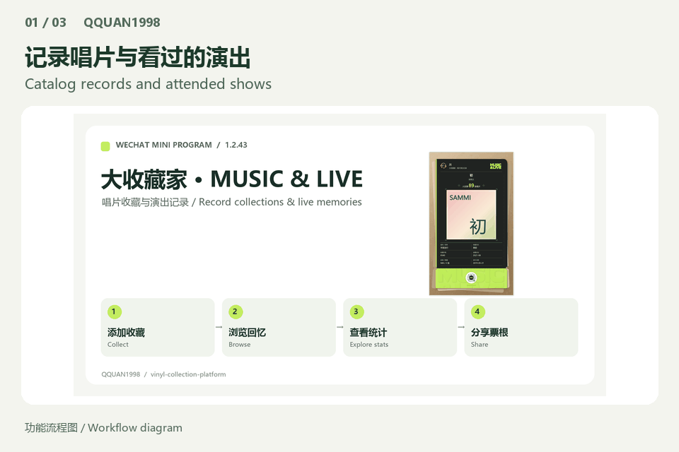
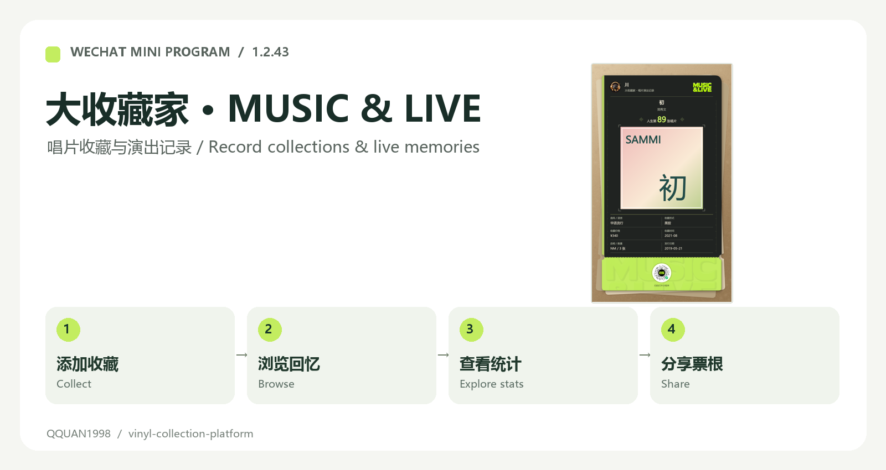
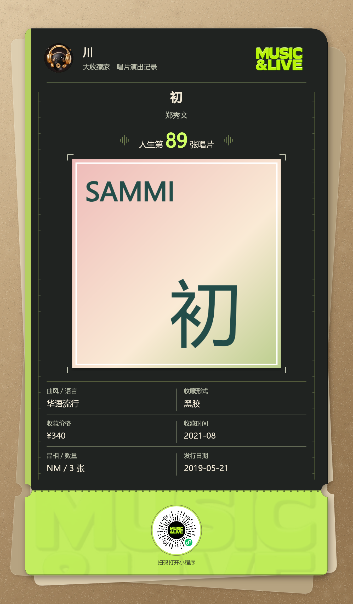
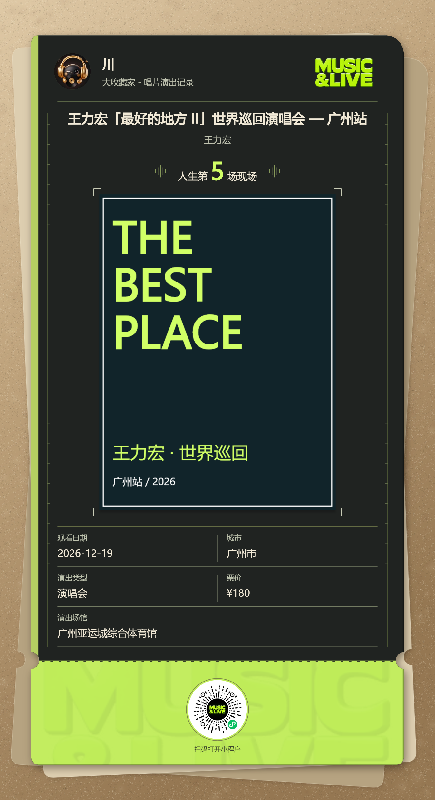
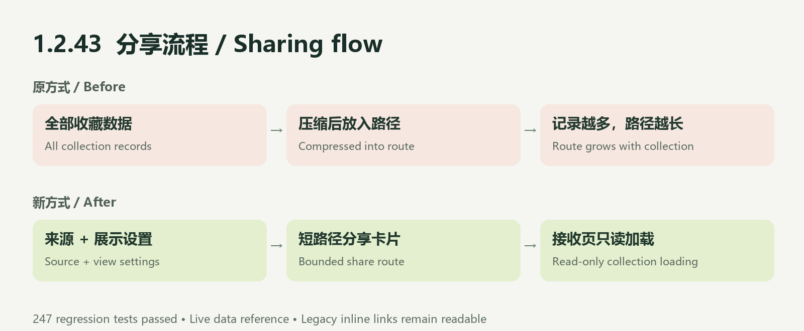

# 把实体唱片，变成私人唱片柜

[English](README.en.md) · [在线图示](https://qquan1998.github.io/vinyl-collection-platform/) · [反馈问题](https://github.com/QQUAN1998/vinyl-collection-platform/issues)



> 适合实体唱片收藏者及微信小程序开发者。 在线图示只展示本地示例，不连接你的微信收藏；真实小程序体验需要微信及相应权限。

<a id="quick-start"></a>

## 三步开始

1. 先打开在线图示，查看唱片和演出票根示例，无需登录。
2. 开发体验：克隆仓库，用微信开发者工具导入 apps/miniprogram。
3. 使用自己的 AppID 和云环境；先阅读完整 README 中的后端与配置说明。

```text
git clone https://github.com/QQUAN1998/vinyl-collection-platform.git
```

[中英文推广文案](docs/LAUNCH.md) · [本次文档更新](docs/UPDATES.md) · [版本记录方法](docs/RELEASING.md)

---

# 大收藏家 · 唱片演出记录

[English](README.en.md) · [1.2.43 更新说明](docs/releases/1.2.43.zh-CN.md)



用微信记录实体唱片、收藏资料和看过的演出，浏览自己的收藏，查看统计并生成分享票根。

## 主要功能

| 场景 | 可以做什么 |
| --- | --- |
| 唱片柜 | 搜索、手动或批量录入；记录版本、介质、数量、品相、价格和收藏日期 |
| 演出集 | 链接识别或手动添加；记录日期、城市、场馆和花费；添加后默认已看过 |
| 统计与时间线 | 查看收藏概览、年度分布、艺人排行、花费和完整时间线 |
| 分享 | 分享收藏页面、统计和时间线；生成唱片及演出票根海报 |
| 个人设置 | 导入导出、电视绑定、操作手册；简体、繁体、英文和日文 |

## 票根示例

以下是本地示例数据的实际 Canvas 导出，用于展示版式，不代表真实用户收藏或发行信息。

| 唱片票根 | 演出票根 |
| --- | --- |
|  |  |

## 1.2.43 修复



统计分享改为携带收藏来源和展示设置的短路径，接收页通过既有公开收藏接口只读加载数据。同步覆盖唱片统计、演出统计和时间线，并处理失败重试与旧分享缓存。

本次提交前 **247 项回归测试通过**，包引用检查通过。2026-11-12 已上传体验版并提交微信审核；这不代表审核通过或正式上线。手机微信实际发送仍需真机确认。

## 本地开发

1. 安装 Node.js 22+、Python 3 和微信开发者工具。
2. 在微信开发者工具导入 `apps/miniprogram`，配置你自己的 AppID 及云服务；仓库现有项目标识不授予任何云访问权限。
3. 后端按 [云托管说明](docs/wechat-cloud-hosting.md) 配置你自己的数据库与环境变量。密钥只保存在本地或部署平台。
4. 修改生成源后，在仓库根目录执行：

```sh
python migration/apply-ui.py
node migration/verify-package.cjs
node --test migration/*.test.cjs apps/miniprogram/tests/*.test.js
```

上传使用的是已生成的 `apps/miniprogram`。`migration/ui` 和补丁脚本是界面修改源；`migration/baseline` 是哈希校验的原始基线。生成器可从相对路径重建，不依赖作者电脑目录。

## 工程目录

| 目录 | 内容 |
| --- | --- |
| `apps/miniprogram` | 本次 1.2.43 原生小程序完整源码 |
| `migration` | 可重建的界面源、原始基线和回归测试 |
| `apps/api` | Node.js API 与数据库模型，沿用远端已有版本 |
| `apps/tv-apk` | 电视端工程 |
| `packages/shared` | 三端共享类型及规则 |

本项目当前不包含已启用的会员收费、激励广告、售票或打榜功能。开放源码不提供线上服务账户；封面、艺人名称及第三方数据的使用应遵循各自权利和服务条款。仓库可公开浏览，使用及再分发仍需确认相应文件的授权。
