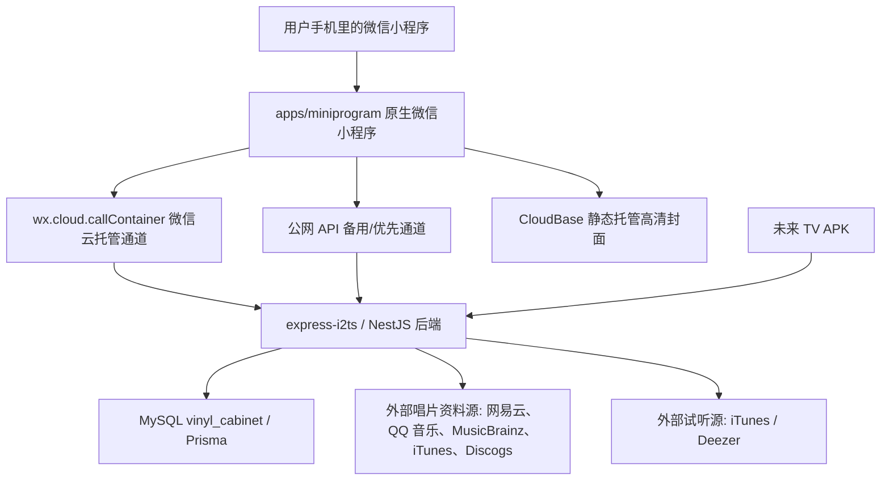

# MY 唱片柜 1.0.00 到 1.0.66 开发历程复盘

本文面向非技术读者，目标不是把每一行代码解释清楚，而是帮你建立一个完整心智模型：这个小程序是怎样从一个想法、原型和连续截图反馈，逐步变成一个有前端、后端、数据库、云部署、体验版和审核版本的产品。

说明：当前仓库里完整保存了 `1.0.42` 到 `1.0.66` 的问题和修复日志，也保存了从 `1.0.22` 开始的上传记录。`1.0.00` 到 `1.0.41` 的逐版文字说明不完整，所以本文把早期阶段按现有任务计划、代码结构、Git 记录和上传包体变化做归纳，不把无法证明的细节写成确定事实。

## 一句话总结

这次 vibe coding 的核心路径是：

> 先用原型确定“唱片柜应该长什么样”，再把它拆成小程序前端、云托管后端、MySQL 数据库、CloudBase 静态封面资源和微信审核上传流程；之后每次根据真机截图和体验问题，做一轮“定位原因 -> 修复 -> 测试 -> 上传体验版 -> 继续反馈”的短迭代。

截至 `1.0.66`，小程序已经具备：

- 微信账号登录和用户独立收藏。
- 搜索添加、手动新建、批量导入。
- 首页照片墙、全部唱片、唱片详情、编辑、删除、上墙/下墙。
- 隐藏唱片库和彩蛋入口，密码 `0816`。
- 批量收藏、批量删除、导出 Markdown。
- 统计页、收藏排行、艺人档案。
- 曲目试听、首页正在试听卡片。
- 今日推荐常驻卡片，推荐来自网易云音乐，点击只看详情不自动收藏。
- 主题设置：标准、白色、暗夜、自定义底色。
- TV 扫码绑定入口和后端同步接口雏形。
- 小程序操作手册。

最新已提交审核的版本是 `1.0.66`。

## 项目身份和当前状态

这次复盘对应的是正式小程序项目，而不是临时测试号：

- 项目名称：唱片柜 / MY 唱片柜。
- 正式小程序 AppID：`wx6c2e2f485f2461c4`。
- 当前代码位置：`C:\Users\16322\Documents\Codex\2026-07-11\codex-threads-019f4f5f-82b6-7ab3-aa91-2`。
- 当前小程序审核版本：`1.0.66`，已提交微信审核。
- 主要项目记忆：`docs/2026-07-15-work-handoff.md`、本文档、以及补充学习交接文档 `docs/vibecoding-mini-program-learning-handoff.md`。

这意味着项目已经从“可以在开发工具里演示”进入了“有正式 AppID、有体验版、有审核版本、有云后端和数据库”的阶段。

## 从 0 到 1.0.66 的阶段

### 阶段 0：想法和静态原型

最早不是直接写小程序，而是先有一个视觉和体验原型。仓库里还保留着 `outputs/vinyl-mini-program-prototype/index.html` 以及多张原型截图，例如首页、九宫格照片墙、详情弹层、稀有度标签等。

这个阶段解决的是产品问题：

- 这个东西是不是“唱片柜”，而不是普通表格。
- 首页应该先看到收藏数量、照片墙和全部唱片。
- 唱片详情要像收藏卡片，有封面、艺人、年份、价格、曲目、稀有度。
- 视觉要偏米白、橄榄绿、浅黄，而不是普通后台系统。

对非技术人员来说，这一步很重要：先用画面和体验说清楚目标，后面的代码才有方向。

这一步后来沉淀成几个非常具体的 UI 判断：

- 小程序不是普通后台列表，而是一个“唱片柜”。
- 首页要先让人看到收藏数量、照片墙、最近加入和全部唱片入口。
- 专辑详情要像一张收藏卡，有封面、艺人、年份、价格、曲目和稀有等级。
- 主色使用米白、橄榄绿、黄色、红色和接近 90% 的黑，不走模板化紫蓝渐变风。

### 阶段 1：工程骨架和基础能力，约 1.0.00 到 1.0.22

这一段的逐版日志不完整，但现有任务计划和 Git 记录能确认这些基础工作已经完成：

- 建立 monorepo 项目结构：
  - `apps/miniprogram`：微信小程序前端。
  - `apps/api`：Node.js 后端 API。
  - `apps/tv-apk`：电视 APK 预留目录。
  - `packages/shared`：前后端共享的数据格式和规则。
- 建立共享类型：用户、会员、唱片、收藏、电视设备、错误结构。
- 建立小程序页面结构和底部导航。
- 建立后端 NestJS 服务。
- 建立 Prisma 数据库模型。
- 建立最早的小程序体验版上传流程。

`outputs/miniprogram-upload-1.0.22.json` 是当前能看到的较早上传记录，包体约 `391 KB`。这说明在 `1.0.22` 前，小程序已经从“本地原型”走到了“可以上传到微信体验版”的阶段。

### 阶段 1.5：先让微信小程序能启动

早期导入微信开发者工具时，遇到过一个很典型的小程序启动错误：

```text
app.json: 未找到 ["pages"][0] 对应的 pages/home/index.js 文件
```

原因不是业务逻辑坏了，而是小程序启动规则很严格：它会先读 `app.json` 里的 `pages` 列表，并把第一个页面当作入口。如果 `app.json` 写的是 `pages/home/index`，但真实文件不存在，模拟器就直接启动失败。

修复方式是：

- 修正 `app.json` 中的页面路径。
- 补齐真实页面文件。
- 后续所有新页面都必须登记到 `app.json`。

这个问题让项目建立了一个基础认知：小程序不是普通网页，它的页面路由、入口、组件注册都要符合微信运行规则。

### 阶段 2：小程序主流程和在线资料库，约 1.0.31 到 1.0.41

这一段有上传记录但缺少完整文字描述。结合 Git 提交和当前代码，可以归纳为：核心页面、云同步和在线搜索逐步接上。

关键变化包括：

- 首页、添加、统计、我的四个主入口成型。
- 添加页开始接入在线唱片资料搜索。
- 后端新增资料聚合接口，尝试从多个资料源找专辑。
- 云托管环境和小程序环境不断校正。
- 小程序包体从 `1.0.31` 的约 `414 KB` 增长到 `1.0.41` 的约 `468 KB`，说明功能和页面资源持续增加。

这里最典型的问题是：开发者工具里能跑，不代表体验版里也能跑。体验版要面对微信云环境、真实域名、接口白名单、网络延迟和真机差异。

### 阶段 2.5：按原型逐页还原 UI 和收藏交互

这一段虽然没有完整逐版文字日志，但补充材料里记录了大量真实反馈：页面一开始“能跑”，但还不像一个有审美规则的产品。你持续用截图指出首页、详情卡片、照片墙、底部 tab、图标、颜色、间距和圆角的问题，最后逐步形成了小程序的视觉规范。

最终沉淀下来的规则包括：

- 除专辑封面框外，其他卡片圆角尽量和底部 tab 栏弧度统一。
- 小程序里的黑色改成约 90% 黑，避免纯黑过硬。
- 主色统一使用指定的绿色、黄色、红色。
- 统计排行前三名用颜色强调。
- 底部 tab 选中时不再变成重白底，而是主要改变 icon 和文字颜色。
- 首页照片墙固定 9 格，不足位置用灰底加号占位。
- 唱片卡片保留稀有度等级体系，例如 `N`、`R`、`SR`、`SSR`、`UR`。

收藏模型也从“有一张专辑”扩展成“我以什么形式收藏了这张专辑”。补充材料里明确记录，唱片形式不只黑胶，最终支持了 11 种：

- 黑胶
- CD
- VCD
- DVD
- 蓝光
- 磁带
- USB
- 数字专辑
- LD
- VHS
- MD

这里最重要的理解是：唱片形式属于“用户这条收藏记录”，不属于“公共专辑资料”。同一张专辑，用户 A 可能收藏黑胶，用户 B 可能收藏 CD，所以介质、价格、数量、品相、备注都应该放在收藏记录里。

### 阶段 3：登录、搜索、批量导入和隐藏唱片库，1.0.42 到 1.0.50

这一阶段开始有清晰版本记录。

| 版本 | 重点变化 |
| --- | --- |
| `1.0.42` | 修复微信云托管登录优先逻辑。 |
| `1.0.43` | 修复编辑个人资料保存后不更新。 |
| `1.0.44` | 修复批量导入无结果自动创建、添加页最近加入、免费口径文案。 |
| `1.0.45` | 修复批量在线搜索，支持“艺人 + 专辑名”宽松匹配。 |
| `1.0.46` | 操作手册新增“更多”入口，进入隐藏唱片库，密码 `0816`。 |
| `1.0.47` | 修复隐藏唱片库列表乱码、收藏前登录、封面打包。 |
| `1.0.48` | 隐藏唱片库封面从 WebP 改为 JPG，处理真机空白风险。 |
| `1.0.49` | 隐藏唱片库封面改用 CloudBase 静态托管高清 JPG，包体降到约 `971 KB`。 |
| `1.0.50` | 保留原微信云托管登录环境，继续使用 CloudBase 高清封面。 |

这里有一个很关键的产品和技术取舍：隐藏唱片库有 385 张唱片，如果把所有高清封面直接塞进小程序包里，包体会变大，真机还可能显示缩略图或空白。所以最后改为：

- 小程序包里只放代码和轻量资源。
- 385 张高清 JPG 放到 CloudBase 静态托管。
- 小程序需要显示封面时，再用 URL 加载远程图片。

这就是第一次明显的“前端包体”和“远程资源”分工。

### 阶段 4：账号稳定、个人资料、批量删除和异常诊断，1.0.51 到 1.0.56

| 版本 | 重点变化 |
| --- | --- |
| `1.0.51` | 修复登录启动弹窗、账号状态保留、云登录失败备用通道、资料保存后状态同步。 |
| `1.0.52` | 修复登录需要点多次；账号创建和头像昵称授权拆开；云托管登录增加短重试。 |
| `1.0.53` | “添加 - 全部唱片”新增批量删除，仅本人可操作，分享访客只读。 |
| `1.0.54` | 批量删除本地即时移除，后台同步云端，新增全选/取消全选，避免卡在删除中。 |
| `1.0.55` | 修复统计艺人档案为空；修复个人卡片横杠昵称和同步提示溢出。 |
| `1.0.56` | 修复单个 iPhone 用户批量加入失败的防护和诊断，字段清洗、部分成功、错误记录。 |

这一阶段的特点是：功能已经能用，但真实用户一测，就会暴露状态管理问题。

例如登录问题的根因不是“按钮坏了”，而是有几件事混在一起：

- 创建账号需要微信身份。
- 同步头像昵称是另一件事。
- 云托管冷启动或网络抖动可能失败。
- 本地没有保存好上一次成功登录状态。

解决方案就是拆开：

- 先完成账号创建，不再强制等待头像昵称授权。
- 成功登录后把 token、用户资料、收藏快照保存到本地。
- 云托管登录失败时给一次备用路径或短重试。
- `-` 这种微信昵称占位符不再当作真实昵称保存。

这对产品理解很重要：很多“用户觉得慢/失败”的问题，本质不是界面，而是身份、网络、缓存、数据写入这几条链路没有分清。

### 阶段 5：曲目试听和首页正在试听卡片，1.0.57 到 1.0.60

| 版本 | 重点变化 |
| --- | --- |
| `1.0.57` | 新增曲目试听接口和小程序详情页试听入口。 |
| `1.0.58` | 首页新增“正在试听”小卡片；离开详情页不再立刻停止试听；隐藏库艺人别名合并。 |
| `1.0.59` | 优化正在试听卡片视觉，放大封面和播放按钮，加入 `NOW PLAYING`。 |
| `1.0.60` | 继续按真机截图调整试听卡片和分享海报；播放/暂停换用户提供图标；海报改真实小程序码。 |

试听功能不是简单在前端放一个播放按钮。它最终变成了：

- 后端新增 `/api/catalog/preview`：根据歌曲、艺人、专辑找试听地址。
- 后端新增 `/api/catalog/preview/stream`：把外部音频代理给小程序播放。
- 后端先查 iTunes，再用 Deezer 兜底。
- 后端做短期缓存：命中缓存 7 天，找不到也缓存 1 天，减少重复等待。
- 前端详情页只负责显示按钮和播放状态。
- 首页用全局试听状态显示“正在试听”卡片。

为什么要后端代理音频？因为小程序直接播放外部音频会受域名、格式、跨域和稳定性影响。后端代理相当于“中转站”，小程序只面对自己的服务。

### 阶段 6：下线分享海报、批量接口和性能优化，1.0.61

`1.0.61` 是一个偏工程治理的版本。

主要变化：

- 统计页分享海报下线，删除入口、画布生成逻辑、海报素材和操作手册文案。
- 隐藏唱片库长列表封面懒加载，不再一进页面就同时拉 385 张封面。
- 一键收藏全部优先走新后端接口 `POST /api/collections/batch-upsert`。
- 如果新接口失败，前端自动回退到旧版逐条保存。
- 后端批量接口通过 GitHub main 提交 `862b15d feat: add batch collection upsert API` 发布并验证。

这里的学习点是：有些功能下线也是产品进步。分享海报效果不佳、维护成本高、还可能影响包体和复杂度，所以先删掉，让主流程更稳。

### 阶段 7：首页慢加载和主题设置，1.0.62 到 1.0.63

| 版本 | 重点变化 |
| --- | --- |
| `1.0.62` | 修复首页收藏慢加载；新增主题设置，支持标准、白色、暗夜、自定义底色。 |
| `1.0.63` | 继续修复旧 token 恢复账号身份后的收藏加载；主题入口换成用户提供的调色盘 SVG；主题页改成统一 UI。 |

当时真实现象是：用户登录没问题，但首页会先显示 `0` 张，等接近一分钟才看到自己的收藏。

最终原因：

- 小程序有登录 token 时，仍然优先走 `wx.cloud.callContainer` 拉收藏。
- 这条通道在某些情况下很慢，要等超时后才回退公网接口。
- 启动时没有先恢复上一次成功拉到的收藏快照。

解决方案：

- 有 token 时优先走公网 API。
- 本地缓存最近一次云端收藏、手动唱片和照片墙顺序。
- 启动先显示本地缓存，让用户尽快看到旧数据。
- 后台再刷新云端最新数据。
- 如果本地只有旧 token 但账号资料没完全恢复，则用云端 owner 反向恢复账号态。

主题设置则建立了一套主题系统：

- 标准模式：原本暖白底。
- 白色模式：更干净的纯白底。
- 暗夜模式：低亮度深色界面。
- 自定义底色：用户自己选背景色。
- 微信顶部导航栏背景也尽量跟随主题。

注意：微信右上角系统胶囊按钮本体不能完全自定义，只能同步它背后的导航栏背景。

### 阶段 8：暗夜模式、字体规范和试听重试，1.0.64 到 1.0.65

| 版本 | 重点变化 |
| --- | --- |
| `1.0.64` | 修复暗夜模式文字和卡片可读性；统一调色盘图标样式；试听地址查询和音频播放各增加一次自动重试。 |
| `1.0.65` | 修复主题设置页字体大小规范、“我的”页资料卡暗夜可读性、唱片弹层浅卡文字过淡。 |

这类问题不是逻辑坏了，而是“在某个主题、某张卡片、某台手机上看不清”。

最终处理方式是把颜色从零散写法变成统一变量：

- 页面背景变量。
- 主文字变量。
- 次级文字变量。
- 卡片背景变量。
- 输入框背景变量。
- 按钮变量。
- 弹层专用深色文字变量。

换句话说，暗夜模式不能只把背景变黑，还要重新定义所有文字、卡片、按钮、分割线、标签的颜色关系。

试听偶发失败的原因判断为外部试听地址查询或音频流瞬时失败。解决方案不是复杂重写，而是在两个阶段各增加一次轻量重试：

- 找试听地址失败时重试一次。
- 音频播放阶段失败时再重试一次。

### 阶段 9：今日推荐、统计口径和操作手册，1.0.66

`1.0.66` 是当前最新审核版本。

主要功能：

- 首页照片墙和全部唱片之间的模块改为常驻卡片。
- 用户正在试听时，显示 `NOW PLAYING / 正在试听`。
- 用户没在试听时，显示 `DAILY PICK / 今日推荐`。
- 推荐根据用户已收藏艺人生成。
- 只保留网易云音乐 `NETEASE` 可用专辑，避免推荐国内平台没有的国外专辑。
- 排除用户已经收藏的同资料源专辑，或同艺人同名专辑。
- 推荐结果按日期缓存，同一天不重复刷新。
- 点击 `GO!` 只进入专辑详情页，可以试听，但不会自动加入收藏。
- 只有用户在详情页主动点“加入收藏”，才会保存到收藏。

后续补丁：

- 彩蛋隐藏唱片库和统计页金额统一改为 `price * quantity`。
- `Memories` 默认收藏口径修正为 `9700 x 1`。
- 今日推荐先复用本地可用推荐卡片快速显示，再后台刷新。
- 推荐后台检索收窄到最多 2 个艺人、每个 18 条网易云结果。
- 小程序操作手册扩展为完整说明，覆盖首次收藏、今日推荐、试听、主题、统计、更多收藏、导入导出等。

## 当前系统整体结构

可以把现在的小程序理解成五层。



### 1. 小程序前端

位置：`apps/miniprogram`

它负责用户看到和点击的一切：

- 首页：`pages/cabinet/index`
- 添加页：`pages/add/index`
- 全部唱片：`pages/all-collection/index`
- 手动新建：`pages/manual-add/index`
- 批量输入、搜索结果、确认加入：
  - `pages/batch-input/index`
  - `pages/search-results/index`
  - `pages/batch-confirm/index`
- 唱片详情：`pages/album-detail/index`
- 收藏编辑：`pages/collection-edit/index`
- 统计页：`pages/stats/index`
- 艺人/风格档案：`pages/archive-profile/index`
- 我的页：`pages/account/index`
- 主题设置：`pages/theme-settings/index`
- 操作手册：`pages/user-guide/index`
- 隐藏唱片库：`pages/easter-library/index`

可以用这张页面地图理解当前前端：

| 页面 | 用户理解 |
| --- | --- |
| 首页 | 我的唱片柜、收藏数量、照片墙、今日推荐/正在试听、全部唱片入口 |
| 添加 | 搜索、手动新建、批量输入、进入全部唱片 |
| 全部唱片 | 展示用户所有收藏，支持搜索、查看、分享和本人管理 |
| 专辑详情 | 看封面、曲目、稀有度、试听，也可以主动加入收藏 |
| 收藏编辑 | 修改价格、数量、品相、形式、备注、收藏日期 |
| 统计 | 看收藏分布、排行、形式占比、艺人或风格档案 |
| 我的 | 账号资料、主题设置、操作手册、导入导出、TV 绑定 |
| 隐藏唱片库 | 通过密码 `0816` 进入的扩展唱片库 |

前端不是直接把所有逻辑堆在页面里，而是拆成服务：

- `cloud-api.js`：和后端通信，登录、拉收藏、保存收藏、删除收藏、批量保存。
- `catalog-api.js`：搜索在线唱片资料。
- `collection-service.js`：本地收藏数据处理。
- `stats-service.js`：统计数量、金额、排行。
- `daily-recommendation-service.js`：今日推荐。
- `preview-player-service.js`：试听播放状态。
- `theme-service.js`：主题和导航栏颜色。
- `auth-state-service.js`：本地登录状态和收藏快照。
- `easter-library-service.js`：隐藏唱片库。
- `tv-login-service.js` / `tv-sync-service.js`：电视绑定和同步。

### 2. 后端 API

位置：`apps/api`

后端是一个 NestJS 服务，部署在微信云托管服务 `express-i2ts`。它负责：

- 创建和识别用户。
- 保存每个用户自己的收藏。
- 处理收藏列表、添加、编辑、删除、批量保存、批量删除。
- 聚合外部唱片资料源。
- 查找和代理试听音频。
- 提供 TV 绑定和读取数据接口。
- 统一处理错误和校验。

主要模块：

- `AuthModule`：登录、token、用户资料。
- `CloudCollectionsModule`：云端收藏。
- `CatalogModule`：唱片搜索、专辑详情、试听。
- `TvDataModule`：电视端数据和扫码登录。
- `DatabaseModule`：Prisma 数据库连接。

主要接口：

- `POST /api/auth/cloud-login`
- `GET /api/me`
- `GET /api/collections/me`
- `POST /api/collections`
- `POST /api/collections/batch-upsert`
- `PATCH /api/collections/:id`
- `DELETE /api/collections/:id`
- `POST /api/collections/batch-delete`
- `GET /api/collections/shared/:ownerId`
- `GET /api/catalog/search`
- `GET /api/catalog/albums/:provider/:providerId`
- `GET /api/catalog/preview`
- `GET /api/catalog/preview/stream`
- `POST /cloud/vinyl-data/tv-login/session`
- `POST /cloud/vinyl-data/tv-login/session/:code/confirm`

### 3. 数据库

当前使用 MySQL，数据库名是 `vinyl_cabinet`，通过 Prisma 管理结构。

核心表可以用业务语言理解：

- `users`：谁在使用小程序。每个微信 openid 对应一个用户。
- `albums`：唱片资料。可以来自平台资料库，也可以是用户手动创建。
- `album_tracks`：一张唱片下面的曲目。
- `collections`：某个用户收藏了哪张唱片，数量、价格、品相、日期、备注是什么。
- `memberships`：会员记录，虽然当前小程序主流程已弱化免费/VIP文案，但底层模型还在。
- `membership_orders`：会员订单，为未来支付留口。
- `tv_devices`：电视设备绑定。
- `sync_events`：同步事件记录。
- `audit_logs`：审计日志，为以后人工修正或后台运营留口。

其中最重要的是 `collections`。它不是单纯记录“我有这张专辑”，还记录：

- `purchasePriceCents`：购买价格。
- `quantity`：数量。
- `condition`：品相。
- `mediumKey`：介质，例如黑胶。
- `collectedAt`：收藏日期。
- `note`：备注。

所以后面统计金额时必须用“单价 × 数量”，这就是 `1.0.66` 修复统计口径的原因。

### 4. 存储和缓存

现在同时有几类“存储”，它们作用不同：

| 存储位置 | 存什么 | 为什么 |
| --- | --- | --- |
| MySQL | 用户、唱片、收藏、电视设备等正式数据 | 长期保存，换手机也在 |
| 微信小程序本地缓存 | token、用户资料、上次收藏快照、主题、今日推荐缓存 | 提升启动速度，避免每次打开都等网络 |
| CloudBase 静态托管 | 385 张隐藏唱片库高清封面 | 减小小程序包体，避免真机封面低清/空白 |
| 后端内存缓存 | 搜索结果、专辑详情、试听结果 | 减少重复请求外部平台 |
| 小程序包内资源 | 图标、页面、样式、少量种子数据 | 小程序运行必需 |

一个重要经验是：不是所有东西都应该塞进小程序包里。高清封面、外部数据、试听音频，都应该放到网络侧按需加载。

### 5. 部署和上传

现在有两条发布线：

第一条是后端发布：

- 后端代码在 `apps/api`。
- Dockerfile 在仓库根目录。
- 发布到微信云托管服务 `express-i2ts`。
- 云托管连接 MySQL。
- 环境变量里保存数据库、微信 AppSecret、token secret 等敏感信息。
- 敏感信息不写入仓库。

第二条是小程序上传：

- 小程序代码在 `apps/miniprogram`。
- 正式小程序 AppID 是 `wx6c2e2f485f2461c4`。
- 使用微信开发者工具 CLI 上传体验版。
- 上传后会生成 `outputs/miniprogram-upload-x.y.z.json`。
- `1.0.66` 最终包体约 `1.0 MB`，准确值 `1077832` bytes。
- 最新 `1.0.66` 已在微信公众平台提交审核，状态为审核中。

需要注意：小程序里的分享能力由两部分组成。代码里可以实现 `onShareAppMessage` 和分享入口，但真机是否允许分享，还受微信平台状态影响。如果体验版或审核状态下出现“由于小程序违规，分享功能暂时无法使用”一类提示，不一定是代码错误，也可能和小程序主体、类目、隐私协议、审核状态或平台风控有关。

## 关键问题、最终原因和解决方案

| 问题 | 表面现象 | 最终原因 | 解决方案 |
| --- | --- | --- | --- |
| 小程序启动失败 | 开发者工具提示找不到首页文件 | `app.json` 中登记的入口页面和真实文件路径不一致 | 修正页面路径，补齐页面文件，所有页面统一登记到 `app.json` |
| 页面不完整 | 只看到一个首页或部分入口不见 | 页面未登记、底部导航未补齐或二级页未实现 | 补全 `app.json` 页面列表和底部导航入口 |
| UI 不像原型 | 页面像普通列表，不像唱片柜 | 先做了功能，还没按原型还原视觉和交互 | 按截图逐页还原首页、详情、统计、我的页，统一颜色、圆角、tab 和卡片规则 |
| 唱片形式不完整 | 只能记录少数介质 | 收藏模型没有覆盖真实唱片收藏形式 | 加入黑胶、CD、VCD、DVD、蓝光、磁带、USB、数字专辑、LD、VHS、MD 等 11 种形式 |
| 在线搜索体验版不可用 | 开发工具能搜，体验版搜不到 | 云环境、接口地址、资料源召回逻辑不稳定 | 修正云环境、接入后端资料聚合、增加搜索兜底和宽松匹配 |
| 批量导入匹配差 | 输入艺人和专辑后找不到 | 搜索条件太严格，外部资料源字段不统一 | 支持“艺人 + 专辑名”宽松匹配，无结果时自动创建手动唱片 |
| 隐藏唱片库封面空白 | 真机看不到封面或低清 | WebP/本地打包在真机兼容和包体上都有风险 | 改 JPG，再迁移到 CloudBase 静态托管 |
| 小程序包体变大 | 1.0.48 包体到约 `1.77 MB` | 高清封面放进小程序包 | 封面远程托管，包体回落到约 `1 MB` |
| 登录要点很多次 | 用户反复点登录才成功 | 账号创建、头像昵称授权、云托管冷启动混在一起 | 账号登录先完成，头像昵称后同步；本地保存登录态；短重试 |
| 个人卡片显示 `-` | 昵称位置出现横杠 | 微信返回占位值，被当成真实昵称保存 | 清洗 `-`、`—`、`--`，不再覆盖默认昵称 |
| 批量删除卡住 | 删除很多张时一直“删除中” | 前端等待云端逐条删除完成 | 本地先移除，后台同步；增加批量删除接口和失败回退 |
| 统计艺人档案为空 | 排行点进去没有唱片 | 档案页只查内置种子库，没有合并在线/隐藏库收藏 | 档案页合并所有来源唱片后再筛选 |
| 单个 iPhone 批量加入失败 | 4 张唱片保存失败 | 外部专辑字段过长/异常、登录资料未完全同步、旧版诊断不足 | 保存前字段清洗；允许部分成功；记录失败详情 |
| 试听失败或没有声音 | 部分曲目点播放失败 | 外部试听源没有片段，或音频流瞬时失败 | 后端查 iTunes/Deezer，前端查询和播放各重试一次 |
| 离开详情页试听停止 | 用户回首页不能继续听 | 播放状态绑在详情页生命周期上 | 新增全局试听状态，首页显示正在试听卡片 |
| 分享海报效果差 | 海报不好看/维护复杂 | canvas 海报、二维码、素材、暗色/浅色兼容成本高 | 下线分享海报，保留核心功能 |
| 一键收藏全部慢 | 隐藏库 385 张保存慢 | 逐条保存请求太多 | 后端新增 `batch-upsert`，前端优先批量保存，失败再回退逐条 |
| 首页加载接近一分钟 | 打开先显示 0 张，过很久才有收藏 | 优先走慢的 `callContainer`，超时后才走公网；没有本地快照 | 有 token 时优先公网；启动先恢复本地收藏快照，再后台刷新 |
| 主题设置 UI 不统一 | 调色盘图标和上下图标不一致 | 新入口样式没有复用现有工具行规范 | 换用户提供的 SVG，并统一图标背景和绿色系样式 |
| 暗夜模式看不清 | 白卡浅字、统计页和弹层文字发灰 | 只改背景不够，文字和卡片变量没成体系 | 建立主题变量，针对卡片、输入框、弹层、按钮分别定义颜色 |
| 字体大小不规范 | 主题设置说明文字过大 | 使用默认文本字号，未按列表小字规范 | 给模式说明补小字号样式 |
| 今日推荐加载慢 | 卡片等待在线搜索 | 每次要查多个艺人的网易云结果 | 先显示本地缓存推荐，再后台刷新；最多查 2 个艺人，每个 18 条 |
| 今日推荐会不会误收藏 | 用户担心点进去就加入收藏 | 推荐卡片如果复用添加流程容易混淆 | 点击只进入临时详情资料池，不写收藏；只有主动点加入收藏才保存 |
| 统计总金额不对 | 应该 18 万多，显示 16 万多 | 只加了单价，没有乘收藏数量 | 统一改为 `price * quantity`，首页、统计页、排行口径一致 |
| 分享提示违规 | 手机端提示无法分享 | 代码分享入口只是必要条件，微信平台审核、类目、隐私、主体状态也会影响分享 | 保留官方分享代码，正式发布前继续检查微信平台合规配置 |

## 这次 vibe coding 的工作方式

这次不是一次性写完，而是一个非常典型的“边体验边生产”的过程。

### 1. 你用自然语言和截图表达需求

比如：

- “这个地方看不清。”
- “我等接近一分钟才看到收藏。”
- “去看看改成 GO!”
- “今日推荐只看详情，不要自动加入收藏。”
- “暗夜模式下这块白底白字。”

这些都是产品语言，不需要先翻译成代码。AI 的工作是把它翻译成具体文件、接口和状态逻辑。

### 2. 每个问题都要先判断它属于哪一类

常见分类：

- 视觉问题：颜色、字体、布局、图标。
- 状态问题：登录了但页面不知道、缓存没恢复、切页后丢状态。
- 网络问题：云托管慢、外部接口失败、音频流不稳。
- 数据问题：统计口径错、字段过长、重复艺人名。
- 架构问题：本地包体太大、逐条请求太慢、前端直接依赖外部域名。

分类对了，修复方向就不会乱。

### 3. 小程序每次都要过三关

第一关：本地代码检查和测试。

- `miniprogram:test`
- 后端测试
- shared 测试
- build

第二关：上传体验版。

- 生成体验版包。
- 确认包体大小。
- 真机打开体验版。

第三关：真机反馈。

- 看真实手机截图。
- 看加载速度。
- 看暗夜/白色/标准主题。
- 看不同网络和不同手机表现。

小程序开发最容易踩坑的是：本地没问题，不等于体验版没问题；体验版没问题，也不等于真机所有场景没问题。

### 4. 文档是为了防止上下文丢失

你多次遇到“任务卡在上下文”的问题，所以交接文档非常关键。

这次项目里已经有：

- `docs/2026-07-15-work-handoff.md`：持续记录最新修改、原因、版本和测试状态。
- `docs/wechat-cloud-hosting.md`：记录云托管部署方式。
- `tasks/plan.md`：记录从产品到工程的阶段计划。
- `tasks/todo.md`：记录任务完成情况。

这类文档不是给机器看的流水账，而是让后续任何一个 AI 或人接手时，能知道：

- 现在做到哪一版。
- 哪个问题已经修过。
- 为什么当时这样修。
- 哪些是临时方案，哪些是长期结构。

## 非技术人员应该怎么理解“前端、后端、数据库”

可以用开店来类比。

### 前端：店面

小程序前端就是用户看到的店面：

- 首页陈列。
- 添加唱片的柜台。
- 统计墙。
- 我的账号。
- 主题颜色。
- 按钮、卡片、弹窗、图标。

它负责好看、好用、响应快。

### 后端：店员和仓库系统

后端不一定被用户看见，但它决定事情能不能真的发生：

- 你是谁。
- 你收藏了哪些唱片。
- 你能不能删除。
- 推荐要查哪里。
- 试听音频从哪里来。
- TV 端能不能读取你的数据。

它负责规则、权限、数据整理和对外部平台的中转。

### 数据库：账本

数据库是正式账本：

- 用户表。
- 唱片表。
- 收藏表。
- 电视设备表。
- 订单和会员表。

只存在手机本地的数据，换手机可能没了；写进数据库的数据，才是正式保存。

### 云托管：后端运行的地方

微信云托管可以理解成“后端服务运行的房子”。小程序不直接连接 MySQL，也不把数据库密码放在前端，而是先把请求交给云托管里的后端服务 `express-i2ts`。后端确认用户身份、检查权限、整理数据，然后再读写数据库或调用外部资料源。

这也是为什么有些问题看起来发生在小程序页面上，真正原因却在云端链路里：小程序、云托管、后端、数据库、外部资料源缺一环，用户都会觉得“加载慢”或“保存失败”。

### 静态托管：图片货架

CloudBase 静态托管像一个专门放图片的货架。隐藏唱片库 385 张封面都放在那里，小程序需要时再取。

这样小程序本身轻，图片也清晰。

## 当前仍然要记住的边界

- TV APK 目录和后端接口已经预留，但仍需要真机完整联调。
- 会员、支付、订单模型还在底层，但当前小程序主体验已经弱化免费/VIP限制文案；后续如果正式商业化，需要重新梳理支付和审核。
- 今日推荐依赖在线资料源，已经做缓存和范围收窄，但外部平台偶发失败仍然可能发生。
- 试听不是每首歌都有，`NO_PREVIEW` 不一定是 bug，可能是外部平台没有试听片段。
- 微信右上角系统胶囊按钮不能完全自定义。
- 分享功能除了代码入口，还依赖微信平台审核、类目、隐私政策和账号状态。
- 审核版本已是 `1.0.66`，但审核通过前仍应以体验版真机复测为准。

## 如果以后继续用 vibe coding，建议这样提需求

最有效的格式是：

1. 先说你看到的问题。
2. 给截图或录屏。
3. 说你期望它变成什么。
4. 说这个问题在哪个版本出现。
5. 说是否要马上上传体验版。

例如：

> `1.0.66` 体验版，首页今日推荐有时出来慢。我希望先显示上一次推荐，再后台刷新。点进去只看详情不收藏。改完跑测试并上传体验版。

这样的需求里包含了：

- 版本。
- 页面。
- 问题。
- 期望。
- 边界。
- 发布动作。

AI 就能更稳定地完成从改代码到测试再到上传。

## 你这次真正学到的东西

这次不是“AI 帮你写了一个小程序”这么简单，而是你完整走了一遍小产品从 0 到审核版的流程：

- 你先用审美和体验判断定义产品方向。
- 然后把一个静态原型迁移成真实微信小程序。
- 再补上后端、数据库和云部署，让数据真的能保存。
- 再通过体验版和真机截图不断发现问题。
- 每个问题都被拆成原因、修复、验证、上传。
- 最后形成审核版本和交接文档。

如果把这套能力迁移到下一个项目，你已经掌握了最重要的产品开发节奏：

> 不需要一开始就懂所有代码，但要持续说清楚“我看到什么、我想要什么、哪里不对、什么算修好”。AI 可以写代码，但产品判断、审美判断和真实反馈来自你。

这就是这次 vibe coding 最有价值的部分。
