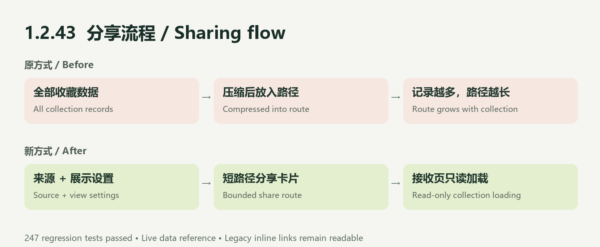

# 1.2.43 · Reliable sharing

- Fixes oversized statistics share routes for larger collections.
- Uses bounded collection references for record statistics, show statistics and timelines.
- Keeps received pages read-only, supports retry, and clears stale shares on refresh/account changes.
- Preserves year, layout, ranking and currency options; legacy inline snapshots remain readable.
- Cloud references show the current shared collection, not a frozen historical snapshot. Large unsynced local collections must sign in and sync first.

Validation: 247 regression tests, 317 baseline checks and package-reference checks passed. Uploaded as an experience build and submitted for WeChat review on November 12, 2026; this is not evidence of approval, production release or physical-device sending success.
