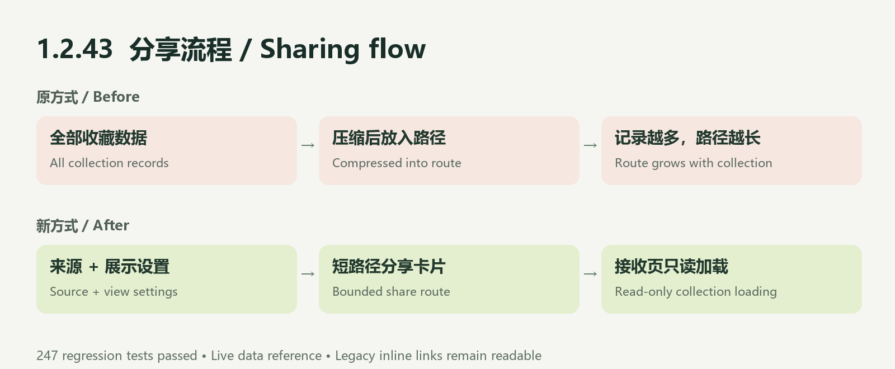

# 1.2.43 · 分享可靠性

- 修复收藏较多时统计分享路径过长的问题。
- 唱片统计、演出统计和时间线统一短路径读取。
- 接收页保持只读；支持加载重试，清除刷新与账号切换后的旧分享缓存。
- 保留年份、版式、排行和币种设置；旧内嵌快照链接兼容。
- 云端引用展示当前共享收藏，并非冻结的历史快照。大量未同步本地收藏须先登录同步。

验证：247 项回归、317 份基线文件和包引用检查通过。体验版已于 2026-11-12 上传并提交审核；未将提审视为正式发布，未声称真机发送已验证。
