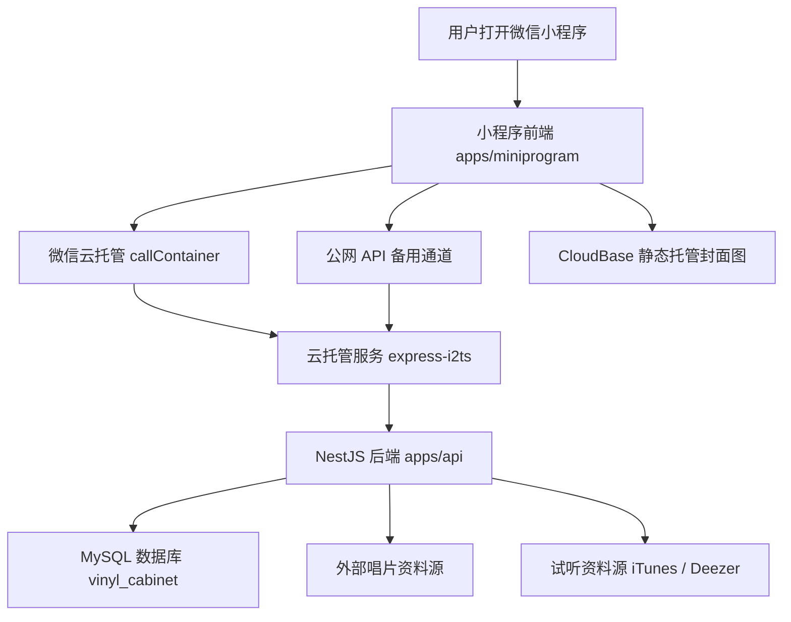

# 唱片柜小程序从 0 到现在的开发历程学习交接文档

更新时间：2026-07-17  
面向对象：非技术人员、产品 owner、后续接手的开发者或 AI 助手  
项目名称：唱片柜 / MY 唱片柜  
正式小程序 AppID：`wx6c2e2f485f2461c4`  
当前代码位置：`C:\Users\16322\Documents\Codex\2026-07-11\codex-threads-019f4f5f-82b6-7ab3-aa91-2`

## 1. 这份文档讲什么

这份文档不是代码说明书，而是一次完整 vibe coding 开发复盘。

它要回答四个问题：

- 这个小程序是怎么从一个想法和 HTML 原型，一步步变成微信小程序的。
- 现在的小程序前端、后端、数据库、图片存储、云托管分别负责什么。
- 开发过程中遇到过哪些问题，最后为什么会发生，又是怎么解决的。
- 作为非技术人员，你应该怎样理解这次从 0 到上线前的产品搭建过程。

一句话总结：

> 这次开发是先用原型确定体验，再用小程序前端做页面，用云托管后端处理账号和数据，用 MySQL 保存用户收藏，用 CloudBase 静态托管承载高清图片，最后通过体验版、真机截图、测试和上传不断修正。

## 2. 从 0 到现在，大概经历了哪些阶段

### 阶段一：先做原型，不急着写小程序

一开始不是直接写微信小程序，而是先参考 HTML 原型：

`outputs/vinyl-mini-program-prototype/index.html`

这个原型定义了最关键的产品感受：

- 不是普通表格，而是“唱片柜”。
- 首页要有收藏数量、照片墙、最近加入、全部唱片入口。
- 专辑点进去要像收藏卡片，有封面、艺人、年份、价格、曲目、稀有等级。
- 整体视觉是米白底、橄榄绿、黄色、红色和 90% 黑，不是普通后台软件。

这一步对非技术人员很重要：先把“它应该是什么感觉”确定下来，代码才知道往哪里走。

### 阶段二：建立正式工程

后来项目被整理成一个正式工程，而不是零散页面。

当前结构是：

```text
vinyl-collection-platform
├─ apps
│  ├─ miniprogram   微信小程序前端
│  ├─ api           后端 API 服务
│  └─ tv-apk        电视端预留目录
├─ packages
│  └─ shared        前后端共用的数据规则
├─ docs             文档和交接记录
├─ outputs          小程序上传结果、原型输出等
└─ Dockerfile       后端部署到云托管时使用
```

你可以这样理解：

- `apps/miniprogram` 是用户手机里看到的小程序。
- `apps/api` 是云端服务，负责登录、保存收藏、搜索资料、试听、TV 同步等。
- `packages/shared` 是前后端都要遵守的统一规则，避免两边说法不一致。
- `docs` 是项目记忆，记录为什么这样做。

### 阶段三：让小程序先能跑起来

最开始导入微信开发者工具时，出现过页面找不到的问题。

当时截图里提示：

```text
app.json: 未找到 ["pages"][0] 对应的 pages/home/index.js 文件
```

原因是：

- `app.json` 里写的首页路径，和真实文件路径不一致。
- 小程序启动时会先读 `app.json`，如果第一个页面不存在，模拟器就启动失败。

解决方案：

- 修正 `app.json` 页面路径。
- 建立真实页面文件。
- 后续所有页面都统一登记到 `app.json`。

现在 `app.json` 里的主要页面包括：

- 首页：`pages/cabinet/index`
- 添加唱片：`pages/add/index`
- 全部唱片：`pages/all-collection/index`
- 手动新建：`pages/manual-add/index`
- 批量输入：`pages/batch-input/index`
- 搜索结果：`pages/search-results/index`
- 批量确认：`pages/batch-confirm/index`
- 专辑详情：`pages/album-detail/index`
- 收藏编辑：`pages/collection-edit/index`
- 收藏统计：`pages/stats/index`
- 我的：`pages/account/index`
- 主题设置：`pages/theme-settings/index`
- 小程序操作手册：`pages/user-guide/index`
- 隐藏唱片库：`pages/easter-library/index`

### 阶段四：按原型逐页还原 UI 和交互

之后进入了大量 UI 还原和交互修正。

你持续用截图指出：

- 首页不像原型。
- 专辑卡片缺少 SSR / UR 等等级。
- 照片墙不是 9 张固定。
- 底部 tab 选中效果太重。
- 图标不显示或不适合。
- 页面之间间距太挤。
- 圆角不统一。
- 黑色不统一。
- 统计页红色不对。

最终形成了现在的小程序设计规范：

- 除专辑封面框外，其他卡片圆角尽量和底部 tab 栏弧度统一。
- 小程序所有黑色改成 90% 黑，不使用纯黑。
- 主色统一使用你指定的绿色、黄色、红色。
- 统计排行前三名用颜色强调。
- 底部 tab 选中时不再变成白色底，只改变 icon 和文字颜色。
- 专辑照片墙固定 9 格，不足的用灰底加号占位。
- 专辑卡片保留稀有度等级体系，例如 N、R、SR、SSR、UR。

这一步的本质是：从“能运行”变成“像一个有审美和规则的产品”。

### 阶段五：让用户可以真的添加和管理收藏

小程序从展示变成可用产品，靠的是收藏流程。

目前用户可以：

- 搜索唱片资料。
- 手动新建唱片。
- 批量输入唱片。
- 添加到自己的收藏。
- 选择唱片形式。
- 编辑价格、数量、品相、备注、收藏日期。
- 删除收藏。
- 上墙 / 下墙。
- 查看全部唱片。
- 分享全部唱片页面给朋友。

你后来补充唱片形式不止黑胶，于是加入了 11 种形式：

- 黑胶
- CD
- VCD
- DVD
- 蓝光
- 磁带
- USB
- 数字专辑
- LD
- VHS
- MD

这里的重点是：唱片形式不是专辑资料本身的一部分，而是“用户这张收藏”的信息。

例如同一张专辑，用户 A 可能收藏黑胶，用户 B 可能收藏 CD，所以它要存在收藏记录里，而不是只存在唱片资料里。

### 阶段六：增加统计、排行和收藏分布

统计页从简单数字，逐步变成收藏分析页。

现在统计内容包括：

- 唱片数量。
- 艺人数量。
- 曲目数量。
- 收藏投入。
- 每月收藏分布。
- 点击月份查看那个月收藏了哪些唱片。
- 收藏排行。
- 按收藏数量 / 总金额切换。
- 收藏形式占比。
- 艺人、风格档案。

开发中遇到过统计口径问题：

表面现象：

- 总金额和用户预期不一致。
- `Memories` 这种高价唱片数量没有正确影响总金额。

最终原因：

- 一开始只统计了单价，没有乘以数量。

解决方案：

- 统一改成 `价格 × 数量`。
- 首页金额、统计页投入、排行金额使用同一套算法。

这个问题非常典型：产品上看是“金额错了”，技术上其实是“统计口径没有统一”。

### 阶段七：加入微信登录和用户独立收藏

一开始的收藏更像本地演示数据。要让它变成真实产品，就必须知道：

- 当前用户是谁。
- 这张收藏属于谁。
- 换手机后还能不能找回。
- 分享给朋友时，朋友看到的是谁的收藏。

因此后面接入了微信登录和云端保存。

当前逻辑是：

- 小程序启动时初始化微信云能力。
- 用户登录后，后端通过微信云托管识别 openid。
- 后端创建或找到对应用户。
- 每个用户的收藏保存到 MySQL。
- 小程序本地也保存一份最近成功的数据快照，用来加快启动。

开发中遇到过登录相关问题：

| 问题 | 原因 | 解决方案 |
| --- | --- | --- |
| 登录要点很多次 | 账号创建、头像昵称授权、云托管冷启动混在一起 | 账号先登录成功，头像昵称后同步 |
| 我的页昵称显示 `-` | 微信返回占位昵称被当作真实昵称 | 清洗 `-`、`--`、`—`，不保存成真实昵称 |
| 打开先显示 0 张 | 先走较慢云通道，超时后才回退 | 本地先恢复缓存，再后台刷新云端 |
| 手机端体验版登录不稳定 | 云托管或网络偶发失败 | 增加 token 缓存、重试和错误诊断 |

这里可以理解为：

> 登录不是一个按钮，而是一整条链路：微信身份 -> 小程序 -> 云托管 -> 后端 -> 数据库 -> 本地缓存。

### 阶段八：建立后端和数据库

当前后端在：

`apps/api`

它是一个 Node.js / NestJS 服务，部署到微信云托管服务：

`express-i2ts`

后端负责小程序不适合直接做的事情：

- 识别微信用户。
- 保存收藏。
- 删除收藏。
- 批量保存和批量删除。
- 给分享页按用户 ID 返回收藏。
- 聚合唱片资料搜索。
- 查询试听资源。
- 给 TV 端提供数据。
- 统一处理错误。

数据库使用 MySQL，数据库名：

`vinyl_cabinet`

云托管里配置的 MySQL 地址示例：

```text
MYSQL_ADDRESS=10.10.108.203:3306
MYSQL_DATABASE=vinyl_cabinet
```

真实密码、AppSecret、Token secret 不写进代码，只放在云托管环境变量里。

数据库里最核心的表可以这样理解：

| 表 | 非技术理解 |
| --- | --- |
| `users` | 用户是谁，每个微信账号对应一个用户 |
| `albums` | 唱片资料，例如标题、艺人、年份、封面 |
| `album_tracks` | 专辑曲目列表 |
| `collections` | 某个用户收藏了哪张唱片、价格、数量、形式、品相、日期 |
| `tv_devices` | 电视端绑定设备 |
| `sync_events` | 同步记录 |
| `audit_logs` | 操作记录，方便以后排查 |

最重要的是 `collections`。

因为一张专辑是公共资料，但“我有这张、我花多少钱、我有几张、是什么形式、哪天收藏”是用户自己的收藏数据。

### 阶段九：用微信云托管承载后端

你后来问过“微信云托管可以吗”。结论是：可以，而且适合当前项目。

目前整体链路是：



为什么要云托管？

- 小程序不能把数据库密码放在前端。
- 小程序不适合直接连 MySQL。
- 小程序直接调用很多外部资料源会受域名和稳定性限制。
- 后端可以统一做权限、缓存、数据清洗和兜底。

所以小程序前端只负责“用户点了什么”，后端负责“这件事能不能做、怎么保存、怎么查资料”。

### 阶段十：解决高清封面和包体问题

隐藏唱片库有大量封面。如果全部放进小程序包，包体会变大，真机也可能加载不稳定。

问题表现：

- WebP 在真机里可能空白。
- 图片放小程序包里包体变大。
- 高清封面打包后不利于更新。

最终方案：

- 把隐藏唱片库封面改为 JPG。
- 把高清封面上传到 CloudBase 静态托管。
- 小程序里只保存图片 URL。
- 打开页面时按需加载图片。

静态托管域名：

`https://vinyl-prod-d0g8u61k95ee7a1e6-1314675814.tcloudbaseapp.com`

这就是“图片存储”和“小程序包体”分离。

### 阶段十一：加入试听和今日推荐

后面小程序不只是收藏管理，还增加了音乐体验。

试听功能：

- 专辑详情页曲目右侧可以试听。
- 后端先查 iTunes，再用 Deezer 兜底。
- 后端代理音频，减少小程序直接依赖外部音频域名的问题。
- 首页有“正在试听”卡片。
- 离开详情页后试听不会立刻停止。

今日推荐：

- 首页照片墙和全部唱片之间常驻一个推荐/试听模块。
- 没有试听时显示 `DAILY PICK / 今日推荐`。
- 正在试听时自动显示 `NOW PLAYING / 正在试听`。
- 推荐从用户已收藏艺人出发。
- 只推荐网易云可用结果，尽量贴近国内用户。
- 点击 `GO!` 只进入详情，不会自动加入收藏。
- 用户必须主动点“加入收藏”才会保存。

这一步的产品意义是：唱片柜不只是仓库，也开始像一个会陪你发现音乐的收藏空间。

### 阶段十二：正式 AppID、体验版和审核

你后来把小程序从测试账号切到正式 AppID：

`wx6c2e2f485f2461c4`

当前 `apps/miniprogram/project.config.json` 已经是正式 AppID。

小程序上传和审核可以这样理解：

- 开发者工具里能看到的是本地开发版。
- 上传后，在微信公众平台会出现体验版。
- 体验版可以给体验成员真机测试。
- 提交审核后，微信审核通过才能成为线上正式版。

你遇到过分享提示“由于小程序违规，分享功能暂时无法使用”。

这个不一定是代码问题，常见原因包括：

- 小程序还在体验版或审核状态。
- 小程序主体、类目、隐私、名称、内容合规还没完全通过。
- 微信平台限制了未正式发布小程序的部分分享能力。

代码里已经写了官方分享入口支持，例如页面的 `onShareAppMessage` 和分享配置；但最终能不能分享，还取决于微信平台审核和账号状态。

## 3. 当前前端结构怎么理解

前端就是用户看到的小程序页面。

它主要做五件事：

1. 显示页面。
2. 接收用户点击。
3. 调用后端接口。
4. 把后端返回的数据展示出来。
5. 在本地缓存一份数据，让打开更快。

重要页面：

| 页面 | 作用 |
| --- | --- |
| 首页 | 展示我的唱片柜、照片墙、今日推荐/正在试听、最近加入 |
| 添加 | 搜索、批量输入、手动新建、进入全部唱片 |
| 全部唱片 | 展示用户所有收藏，支持搜索和分享 |
| 专辑详情 | 看封面、曲目、稀有度、试听、加入收藏 |
| 收藏编辑 | 改价格、数量、品相、形式、备注 |
| 统计 | 看收藏分布、排行、形式占比 |
| 我的 | 账号资料、主题设置、操作手册、导入导出、TV 绑定 |
| 隐藏唱片库 | 通过密码 `0816` 进入的扩展库 |

重要服务文件：

| 文件 | 作用 |
| --- | --- |
| `cloud-api.js` | 小程序和云端后端通信 |
| `catalog-api.js` | 搜索唱片资料 |
| `collection-service.js` | 处理收藏数据 |
| `stats-service.js` | 计算统计数据 |
| `theme-service.js` | 管理主题颜色 |
| `preview-player-service.js` | 管理试听播放 |
| `daily-recommendation-service.js` | 管理今日推荐 |
| `auth-state-service.js` | 保存登录状态和本地快照 |
| `easter-library-service.js` | 隐藏唱片库逻辑 |

## 4. 当前后端结构怎么理解

后端就是小程序背后的“服务员 + 仓库管理员”。

它不会直接展示给用户，但它决定：

- 用户是谁。
- 数据能不能保存。
- 哪些收藏属于这个用户。
- 分享页能看到谁的收藏。
- 外部唱片资料怎么搜。
- 试听地址怎么找。

主要模块：

| 模块 | 作用 |
| --- | --- |
| Auth | 登录、token、微信身份 |
| CloudCollections | 云端收藏增删改查 |
| Catalog | 在线唱片搜索、详情、试听 |
| TV | 电视端绑定和同步 |
| Database | 连接 MySQL |

核心接口：

```text
POST   /api/auth/cloud-login
GET    /api/me
GET    /api/collections/me
POST   /api/collections
POST   /api/collections/batch-upsert
PATCH  /api/collections/:id
DELETE /api/collections/:id
POST   /api/collections/batch-delete
GET    /api/collections/shared/:ownerId
GET    /api/catalog/search
GET    /api/catalog/preview
GET    /api/catalog/preview/stream
```

## 5. 当前存储结构怎么理解

现在不是只有一个地方存数据，而是分工存储。

| 存储位置 | 存什么 | 为什么这样存 |
| --- | --- | --- |
| MySQL | 用户、唱片、收藏、TV 绑定 | 正式长期数据，换手机也能找回 |
| 小程序本地缓存 | token、主题、上次收藏快照、今日推荐缓存 | 打开更快，网络慢时不空白 |
| CloudBase 静态托管 | 隐藏唱片库高清封面 | 减少小程序包体，图片更清晰 |
| 后端缓存 | 搜索结果、试听结果 | 减少重复请求外部平台 |
| 小程序包内 | 页面、样式、图标、少量种子数据 | 小程序运行必需 |

非技术理解：

- MySQL 是正式账本。
- 本地缓存是手机上的临时小抄。
- 静态托管是专门放图片的货架。
- 后端缓存是服务员脑子里的短期记忆。

## 6. 开发过程中所有重要问题、原因和解决方案

| 问题 | 看到的现象 | 最终原因 | 解决方案 |
| --- | --- | --- | --- |
| 小程序启动失败 | 模拟器提示找不到页面 | `app.json` 写的页面路径不存在 | 修正页面路径并补齐页面文件 |
| 其他页面不见了 | 只显示一个首页 | 页面没有登记进 `app.json` 或还没实现 | 补全页面列表和底部导航 |
| UI 不像原型 | 页面太像普通列表 | 只做了功能，没有按原型还原交互 | 按截图逐页还原首页、详情、统计、我的 |
| 专辑卡片缺 SSR 等级 | 点进去不像收藏卡 | 缺少稀有度体系和动画效果 | 加入 N/R/SR/SSR/UR 等级展示和卡片样式 |
| 唱片形式不完整 | 只能选少数格式 | 收藏模型没有覆盖真实唱片介质 | 加入 11 种唱片形式 |
| 照片墙逻辑复杂 | 替换操作绕二级页 | 替换流程不适合手机快速操作 | 改成上墙/下墙，固定 9 格 |
| 详情曲目不能滑动 | 真机里曲目区域滑不动 | 滚动容器设置不适合手机触摸 | 调整详情区域滚动结构 |
| 收藏星标不能取消 | 点一次收藏后不能反向操作 | 状态切换只写了收藏，没有处理取消 | 补充收藏/取消状态逻辑 |
| 搜索区下滑后不方便 | 唱片多了找不到搜索框 | 搜索区跟列表一起滚走 | 将搜索和筛选区域做成更方便使用的结构 |
| 颜色不统一 | 红色、黑色、绿色不一致 | 各页面分散写颜色 | 统一颜色变量，黑色改 90% 黑 |
| icon 不显示 | 替换 icon 后页面空白 | 小程序对 SVG/路径/尺寸比较敏感 | 调整图标资源路径和样式，替换不合适 icon |
| 分享功能提示违规 | 手机端不能分享 | 微信平台账号/审核/类目/合规状态限制 | 代码保留官方分享能力，等待平台审核和合规配置 |
| 登录不稳定 | 要点多次，或头像昵称不同步 | 登录、资料授权、云端创建混在一起 | 账号先登录，资料后同步，增加本地缓存和重试 |
| 首页显示 0 张很久 | 打开慢，过很久才显示收藏 | 先走慢通道，没有先恢复本地快照 | 启动先显示本地快照，再后台刷新云端 |
| 批量加入失败 | 某台 iPhone 保存失败 | 外部资料字段异常、诊断不足 | 保存前清洗字段，允许部分成功，记录失败详情 |
| 隐藏库封面空白 | 真机图片不显示或低清 | WebP 和本地打包不稳定 | 改 JPG，并迁移到 CloudBase 静态托管 |
| 小程序包体变大 | 上传包接近变大 | 大量高清封面打进包里 | 图片远程托管，小程序只放 URL |
| 批量收藏慢 | 385 张隐藏库逐条保存太慢 | 每张唱片都单独请求后端 | 新增批量保存接口，失败时回退逐条保存 |
| 批量删除卡住 | 删除很多张一直等待 | 前端等云端逐条完成 | 本地先移除，后台同步，增加批量删除 |
| 统计金额不对 | 投入金额和预期不一致 | 只算单价，没有乘数量 | 统一改成 `价格 × 数量` |
| 暗夜模式看不清 | 白底浅字、卡片文字过淡 | 只改背景，没有统一文字变量 | 建立主题变量，分别控制文字、卡片、输入框 |
| 试听偶发失败 | 有时点播放失败 | 外部试听源不稳定或没有片段 | iTunes/Deezer 兜底，查询和播放各重试一次 |
| 今日推荐加载慢 | 推荐卡片出来慢 | 每次要在线查多个艺人 | 先用本地缓存，再后台刷新，收窄查询范围 |
| 推荐会不会误收藏 | 点 GO 担心自动加入收藏 | 推荐详情和加入收藏流程容易混淆 | 点击只看详情，必须主动加入才保存 |

## 7. 你作为非技术人员应该学到的核心概念

### 前端：店面

前端就是用户看到的店面：

- 页面长什么样。
- 按钮在哪里。
- 点了之后有没有反馈。
- 信息是否清楚。

### 后端：店员和仓库系统

后端是用户看不见的服务：

- 识别你是谁。
- 判断你有没有权限。
- 保存和读取收藏。
- 调外部资料源。
- 处理错误和兜底。

### 数据库：正式账本

数据库是长期保存的账本：

- 哪个微信用户。
- 收藏了哪些唱片。
- 每张多少钱、几张、什么形式。

### 云托管：后端运行的地方

云托管就是把后端服务放到微信云上运行。

小程序不直接连数据库，而是先问云托管后端。

### 静态托管：图片仓库

静态托管专门放高清封面、图片资源。

这样小程序本身不会太大，图片也能保持清晰。

## 8. 这次 vibe coding 的正确工作方法

这次最有效的开发方式是：

1. 你用自然语言说体验问题。
2. 你发截图指出哪里不对。
3. AI 判断这是 UI、状态、网络、数据还是架构问题。
4. AI 修改代码。
5. 跑测试。
6. 上传体验版。
7. 你用真机继续反馈。

小程序开发最重要的不是“一次写完”，而是持续循环：

```text
截图反馈 -> 找原因 -> 改代码 -> 跑测试 -> 上传体验版 -> 真机验证
```

你这次最有价值的能力不是会不会写代码，而是你能清楚判断：

- 哪里不像原型。
- 哪里不符合真实用户场景。
- 哪个功能会让用户误解。
- 哪个页面操作不顺。
- 哪个展示不够好看。

这些判断是产品 owner 的核心能力。

## 9. 当前还要继续关注的事情

虽然小程序已经从原型走到比较完整的体验版/审核版，但后续仍建议重点关注：

- 微信审核是否通过。
- 分享能力是否在正式版恢复正常。
- 小程序类目、隐私政策、用户协议是否完整。
- 云托管服务 `express-i2ts` 健康状态是否稳定。
- MySQL 环境变量是否配置完整且安全。
- TV 端是否需要继续真机联调。
- 更完整曲库资源替换后，搜索、封面、曲目、统计是否仍正常。
- 若未来做支付/会员，需要重新梳理微信支付、类目和审核合规。

## 10. 后续继续提需求的最佳格式

以后你继续 vibe coding，可以这样说：

```text
版本：体验版 1.0.xx
页面：例如首页 / 添加 / 全部唱片 / 统计 / 我的
问题：我看到什么不对
期望：我希望它变成什么
截图：附图
边界：哪些不要改
动作：改完是否需要测试和上传
```

例子：

```text
体验版 1.0.66，首页今日推荐加载有点慢。
我希望先显示上一次推荐，再后台刷新。
点 GO 只进入详情，不要自动收藏。
改完跑测试并上传体验版。
```

这样的表达最适合 AI 开发，因为它包含了页面、问题、期望、边界和发布动作。

## 11. 最后总结

这个小程序从 0 到现在，真正完成的是三件事：

第一，把一个审美原型变成了可以在微信里运行的小程序。

第二，把本地演示收藏变成了按微信用户隔离、能保存到云端数据库的真实收藏系统。

第三，通过很多轮真机截图反馈，把“能用”不断打磨成“更像产品、更适合收藏用户使用”。

这次开发的核心经验是：

> AI 可以负责写代码、查问题、跑测试和整理结构；你负责判断产品感受、用户场景和最终体验。两者配合起来，就能把一个非技术想法推进成真实小程序。

